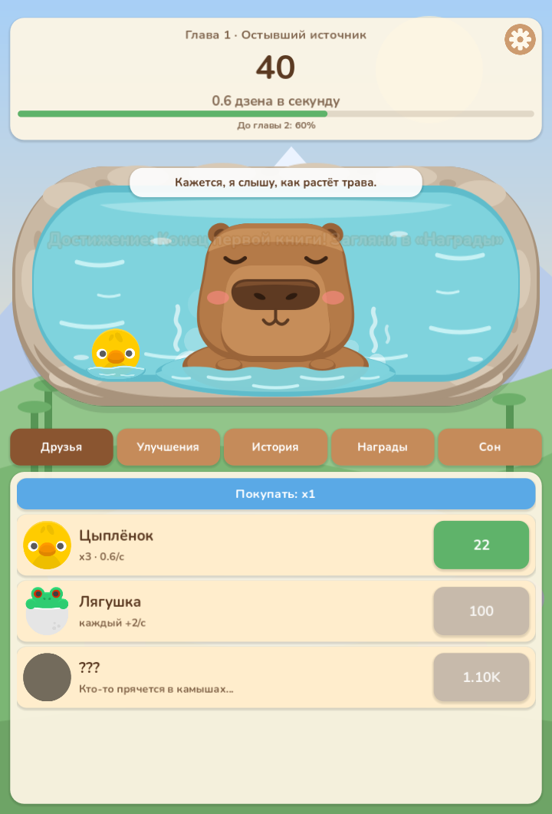
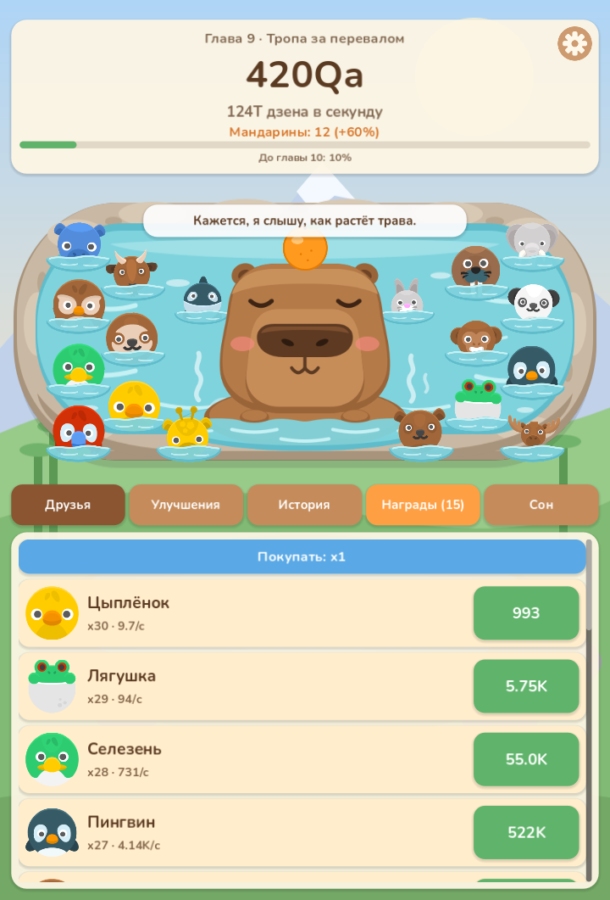
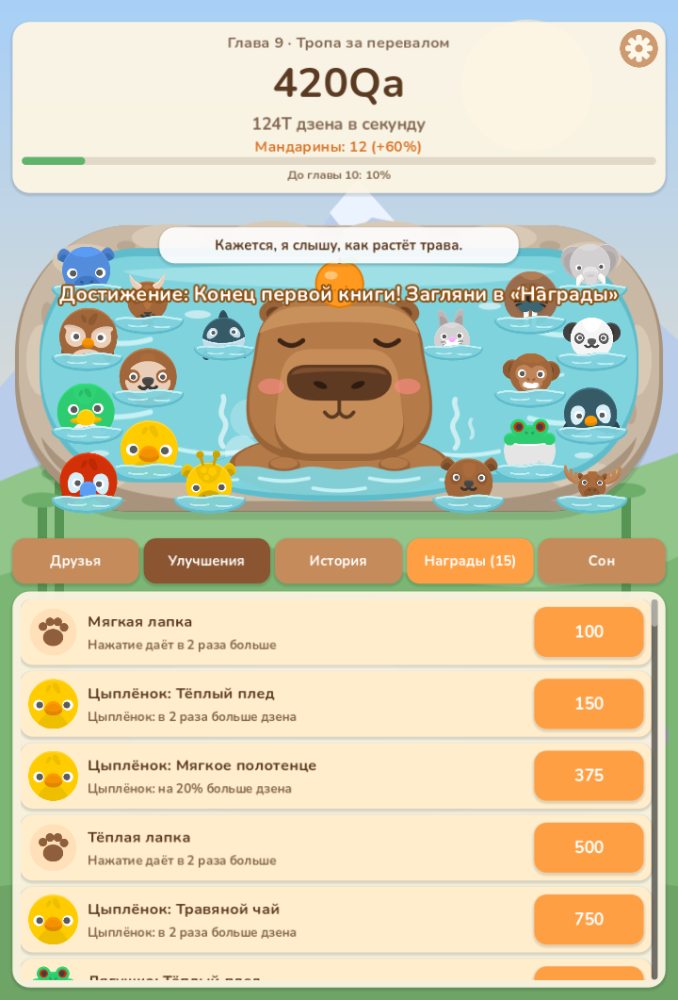
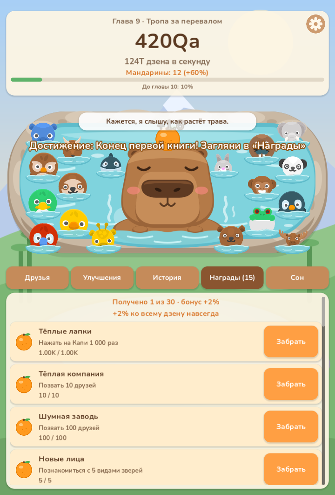

# Capy Springs 🛁

A cozy idle clicker with a story, made in **Godot 4** with **GDScript**.
Capy the capybara sits in a frozen hot spring and warms the valley back to life with zen. Friends come back, the snow melts, and the story unfolds over 16 chapters.

**▶ Play in the browser:** https://poetiha.itch.io/capy-springs

| Start | Friends in the spring | Upgrades | Achievements |
|---|---|---|---|
|  |  |  |  |

## Features

- **Tap and idle economy:** 18 friends give passive income. Prices grow by ×1.15 per purchase, with buy ×1 / ×10 / MAX.
- **Upgrades:** tiered upgrades for every friend, global "all friends" boosts and tap upgrades.
- **Story:** two books with 16 chapters. The background changes with each chapter, and every friend has their own lines.
- **Prestige ("Great Nap"):** reset for golden mandarins that give a permanent bonus.
- **30 achievements** that each give a permanent +2% bonus.
- **Golden mandarin events** with random rewards.
- **Friends appear in the hot spring** next to Capy as you buy them, with a small bobbing animation.
- **Settings:** music and sound volume, language (Russian / English), progress reset.
- **Offline progress:** friends keep earning at a reduced rate for up to 8 hours.
- **Builds:** Web (HTML5) and Windows. The game is designed for portrait mobile (720×1280), with an Android release planned.

## Technical highlights

- **UI built entirely in code** (`scripts/main.gd`) with no hand-placed scenes, so the layout adapts to any screen size.
- **Clean split** between data (`data.gd`), game logic and saves (`game.gd`, autoload) and presentation (`main.gd`).
- **Safe saves:** JSON with a versioned format, atomic writes (`.tmp` file, then rename) and a `.bak` backup.
- **Balance tuned with a simulation script** that models casual and active players to set chapter pacing.
- **82 automated headless tests** covering saves, UI, story progression and the economy.
- **Procedurally generated background music** written as a Godot script.
- **Web touch-input fix** that prevents doubled taps from emulated mouse events.

## Project structure

```
scripts/
  data.gd    # all numbers, texts, chapters, achievements
  game.gd    # economy, saves, prestige, achievements (autoload "Game")
  main.gd    # UI, animations, music, input
assets/      # graphics (SVG/PNG), sounds, music, font
docs/        # screenshots and design notes (in Russian)
```

## Run locally

1. Install [Godot 4](https://godotengine.org/download) (the project uses 4.7).
2. In Godot, choose **Import**, select `project.godot`, then click **Import & Edit**.
3. Press **F5** to play.

## Credits and licenses

- **Code, story, capybara art, sounds and music:** made for this project.
- **Animal sprites:** [Kenney](https://kenney.nl/assets), Animal Pack Remastered, CC0. See `assets/friends/KENNEY_LICENSE.txt`.
- **Font:** [Nunito](https://fonts.google.com/specimen/Nunito), SIL Open Font License 1.1. See `assets/fonts/NUNITO_OFL.txt`.

© 2026 poetiha. The code is published for viewing; all rights reserved.
